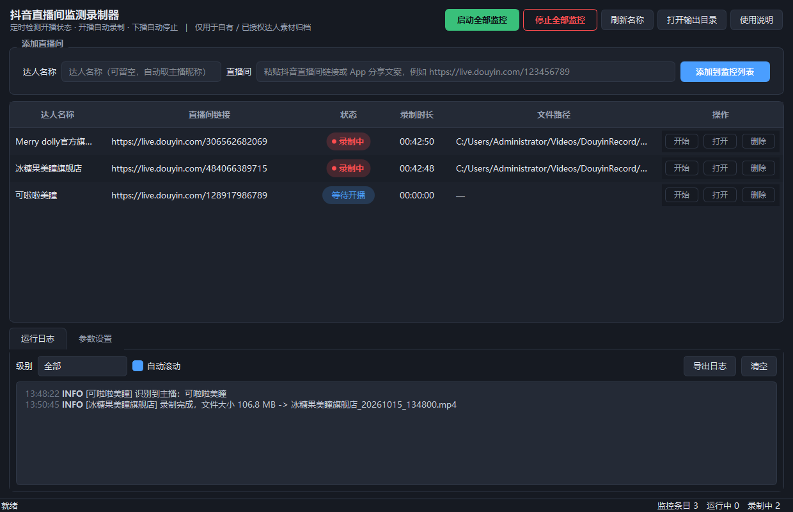

# 抖音直播间监测录制器（DouyinLiveMonitor）

一个 Windows 桌面工具：把抖音直播间链接加进列表，程序定时检测开播状态，
**开播自动录制、下播自动停止**，产出 `达人名称_年月日_时分秒.mp4` 的素材文件。

Python 3.13 + PySide6 + ffmpeg，纯本地运行，单文件打包分发。

> ⚠️ **使用约束**：仅供自有 / 已授权达人直播间的素材归档使用。
> 本工具不包含任何 AI / 视觉识别功能，不做签名破解、加密逆向或风控规避，
> 只读取直播间公开页面返回的数据。请遵守平台规则与相关法律法规。

---



## 背景

做达人投放时，达人开播时间不固定，靠人工盯播、手动录屏效率极低，
而且经常错过开播前半小时的黄金素材。

这个工具的目标是把「盯播 + 录制 + 归档命名」整件事自动化：

- 一次挂号多条直播间，程序自己轮询，不用人守着；
- 开播即录，下播自动停，断流自动分段续录；
- 文件按「达人名 + 时间戳」落盘，事后剪辑不用再对时间轴。

## 功能

| 模块 | 说明 |
| --- | --- |
| 监控列表 | 粘贴直播间链接或 App 分享文案即可添加，支持多条；**添加后自动识别主播昵称**填入「达人名称」列，手动填写的名称优先 |
| 总开关 | 一键启动 / 停止全部监控 |
| 状态轮询 | 按设定间隔检测开播状态：等待开播 → 录制中 → 已结束 / 异常 |
| 自动录制 | 开播即调 ffmpeg 录制，下播自动收尾；断流自动分段续录 |
| 录制参数 | 直录不转码（推荐）或转码（自定义帧率 / 码率）；可限制单文件时长、体积 |
| 配置持久化 | 所有参数保存在程序同目录 `config.yaml` |
| 日志面板 | 实时运行日志，支持级别过滤、导出，落盘到 `logs/livewatch.log` |

## 技术实现

```
┌──────────────┐   Qt Signal（跨线程，自动排队）   ┌──────────────────┐
│  MainWindow  │ ◄──────────────────────────────  │  RoomWorker ×N   │
│  表格/日志   │ ──────── request_stop() ───────► │  QThread/直播间  │
└──────────────┘                                  └────────┬─────────┘
                                                           │
                                    ┌──────────────────────┼──────────────────┐
                                    ▼                      ▼                  ▼
                            ┌───────────────┐     ┌──────────────┐   ┌─────────────┐
                            │ DouyinClient  │     │FfmpegRecorder│   │ NameFetcher │
                            │ 状态探测/解析 │     │ TS→MP4 封装  │   │ 昵称识别    │
                            └───────────────┘     └──────────────┘   └─────────────┘
```

几个关键设计决定：

**1. 一个直播间一个线程，互不阻塞**
`RoomWorker(QThread)` 独立承担「探测 → 起录 → 停止」的闭环，任何一个房间的网络卡顿、
ffmpeg 异常都不会影响其他房间。UI 线程只负责渲染，两者仅通过 Qt Signal 通信，
避免跨线程直接操作控件。

**2. 先写 TS 再封 MP4**
直播流随时可能断，直接写 MP4 一旦进程被杀，文件（尤其是 moov 头）就废了。
所以录制先落到 MPEG-TS（流式格式，天然抗中断），停止后再用 `-c copy` 无损封装成 MP4。
不重编码 = 不损失画质、几乎不占 CPU；封装失败时保留 TS 原文件兜底。

**3. 状态探测做三级降级**
公开 Web 接口对无签名请求会返回空体，所以不能只依赖单一路径：

```
公开 Web 接口（JSON）
   ↓ 失败
页面内嵌数据（React flight 分块，反转义 + 括号配对提取）
   ↓ 失败
关键词兜底 / 用户自填直连流地址
```

每一级失败都把原因写进日志（标明是接口还是页面环节），方便判断是风控变了还是链接错了。

**4. 名称识别不阻塞主流程**
添加链接后由 `NameFetcher` 异步取昵称，不卡 UI；用守护线程而非 QThread，
避免程序退出时出现「QThread destroyed while thread is still running」。

## 快速开始

### 方式一：下载 exe（推荐给使用者）

到 [Releases](../../releases) 下载 `DouyinLiveMonitor_v1.0.0_便携版.zip`，解压后双击 exe。
**无需安装 Python / ffmpeg / 任何运行库**（ffmpeg 已内置）。

> 程序未做数字签名，首次运行 Windows 会提示「已保护你的电脑」，
> 点「更多信息 → 仍要运行」即可。要求 64 位 Windows 10 / 11。

### 方式二：源码运行

```bat
python -m venv .build-venv
.build-venv\Scripts\pip install -r requirements.txt
.build-venv\Scripts\python main.py
```

首次运行会自动生成 `config.yaml`（字段说明见 `config.example.yaml`）。

## 打包

```bat
:: 生成 dist\DouyinLiveMonitor\DouyinLiveMonitor.exe
build.bat

:: 打成可分发到其他电脑的便携 zip
python tools\make_portable.py
```

打包会排除 `config.yaml` 与 `logs/`，避免把本机输出路径、直播间列表带到别的机器；
对方首次运行时自动生成配置，默认输出目录按其系统用户名计算。

## 配置说明

| 字段 | 默认 | 说明 |
| --- | --- | --- |
| `output_dir` | `~/Videos/DouyinRecord` | 录制保存目录 |
| `check_interval` | `20` | 检测间隔（秒） |
| `detect_timeout` | `10` | 单次请求超时（秒） |
| `record_mode` | `copy` | `copy` 直录不转码；`transcode` 转码 |
| `fps` / `video_bitrate` | `30` / `4000k` | 仅转码模式生效 |
| `max_duration_min` / `max_file_size_mb` | `0` | 单文件上限，`0` = 不限 |
| `ffmpeg_path` | 空 | 留空自动查找（内置 → PATH） |
| `cookie` | 空 | 可选，填自有账号 Cookie 可提升检测稳定性 |
| `rooms[].stream_url` | 空 | 可填自有 / 已授权的**直连流地址**，填写后跳过自动解析 |

## 关于开播检测的可靠性

抖音页面结构会不定期调整，自动解析存在失效可能。若某条目长期显示「异常」：

1. 打开「运行日志」查看具体失败原因（会标注是接口还是页面环节）；
2. 点「刷新名称」重试；
3. 在「参数设置」中补充自有账号 Cookie 可提升成功率；
4. 仍不行时，在该条目中填入自有 / 已授权的直连流地址，即可稳定录制。

## 开发中踩过的坑

**文件名变成 `$undefined_20261015_133315.mp4`**
抖音页面的 React flight 数据里，`undefined` 会被序列化成字面量 `"$undefined"`。
按 key 取昵称时第一个命中的就是它，于是直接进了文件名。
修复：统一用 `clean_text()` 过滤 `$` 开头 / `undefined` / `null` 占位符，
并把「取第一个匹配」改成「取第一个有效值」。

**开播瞬间取不到昵称**
开播那一刻页面数据还没稳定，常拿不到昵称，导致文件名只能落到房间号。
修复：真正开始录制前，如果还没有名称，先短暂重探（最多 6 秒）再命名。

**QThread 退出崩溃**
名称识别最初用 QThread，程序关闭时若请求还没结束，线程被析构会抛
`QThread destroyed while thread is still running`。
修复：改用 `threading.Thread(daemon=True)` + 信号桥接，退出时不必等它。

**录制文件被误打开报「无法访问本地存储」**
录制中的临时文件被双击打开，Windows 播放器会报错。
修复：临时目录设为 Windows 隐藏属性，并用 `.tmp` 子目录隔离。

## 目录结构

```
douyin-live-monitor/
├── main.py                    入口
├── livewatch/
│   ├── config.py              YAML 配置读写
│   ├── douyin.py              开播状态探测 + 流地址解析
│   ├── recorder.py            ffmpeg 录制（TS 中转 → MP4 封装）
│   ├── worker.py              监测线程 + 昵称识别
│   ├── main_window.py         主界面
│   ├── ui_theme.py            深色主题 QSS
│   ├── logging_ext.py         日志（文件 + 面板）
│   ├── constants.py           常量与状态枚举
│   └── paths.py               路径 / ffmpeg 定位
├── assets/app.ico             图标（由 tools/make_icon.py 生成）
├── docs/                      截图与使用说明
├── tools/
│   ├── make_icon.py           纯 Python 生成 .ico
│   └── make_portable.py       组装便携 zip
├── config.example.yaml        配置示例
├── DouyinLiveMonitor.spec     PyInstaller 配置
└── build.bat                  一键打包
```

## 说明

仓库只托管源码。`dist/`、`build/`、便携包等产物体积约 480 MB（其中内置 ffmpeg 单体 84 MB），
不纳入版本管理，可执行文件通过 GitHub Releases 分发。
